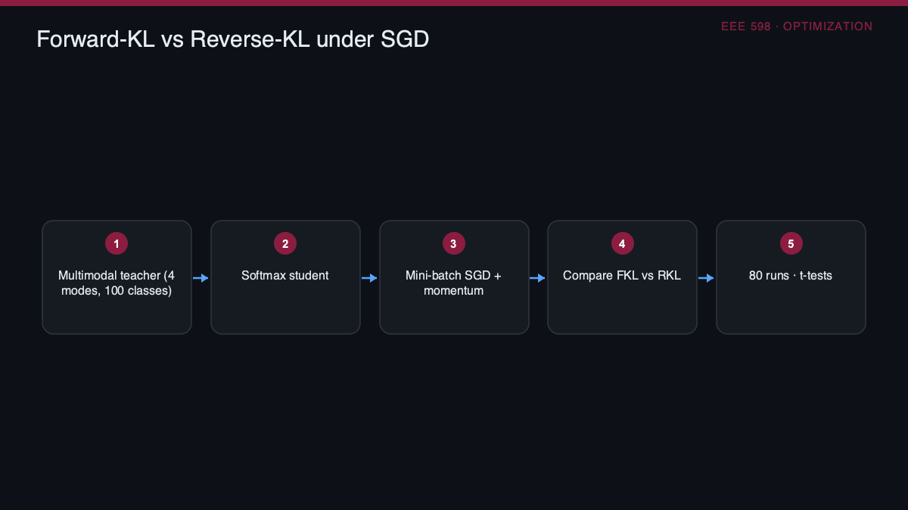

# Stochastic Optimization

> Empirical study of Forward-KL vs Reverse-KL divergence under stochastic gradient descent

     



### 🌐 Live project page → **https://selsaady1.github.io/eee598-stochastic-optimization/**

## Overview
A graduate stochastic optimization project (EEE 598, ASU) comparing two probability distribution matching objectives: Forward Kullback-Leibler (FKL) and Reverse Kullback-Leibler (RKL) divergence. A parameterized softmax student distribution is trained via mini-batch SGD with momentum to match a fixed multimodal teacher over 100 classes. The study runs 20 independent trials per configuration to evaluate convergence, stability, and distribution quality, with statistical significance testing of the results.

**Highlight:** Mode coverage: FKL 95% vs RKL 68% (p < 0.001) across 20 independent runs

**Highlight:** Mode coverage: FKL 95% vs RKL 68% (p < 0.001) across 20 independent runs

## Key Achievements
- Designed a controlled experiment isolating optimization dynamics: a fixed multimodal teacher (four modes at positions 20, 40, 60, 80 over 100 classes) and a softmax-parameterized student trained from 10,000 teacher samples
- Ran 80 total optimization runs (20 seeds x 2 objectives x 2 batch sizes) with momentum SGD (lr=0.01, momentum=0.9, 2,000 iterations) for statistically rigorous comparison
- Empirically confirmed mean-seeking vs mode-seeking theory: FKL captured 95 +/- 3 percent of teacher modes while RKL captured only 68 +/- 8 percent
- Validated findings with paired two-sample t-tests, finding highly significant differences in mode coverage (p < 0.001), final loss (p = 0.003), and total variation distance (p = 0.007)
- Quantified stochasticity sensitivity, showing RKL is more affected by mini-batch noise than FKL and that larger batch sizes (128 vs 32) reduce variance for both objectives

## Approach
The distribution matching problem was framed as optimizing a softmax student distribution against a fixed multimodal categorical teacher using mini-batch stochastic gradient descent with momentum. Stochasticity was introduced by sampling mini-batches (size 32 and 128) from 10,000 teacher-drawn samples rather than the analytical distribution. Convergence was defined as the iteration where loss fell below 1.05x the run minimum, and performance was assessed via iterations-to-convergence, final loss, total variation distance, and mode coverage. Twenty independent runs per configuration with paired t-tests provided statistical rigor.

## Tools & Technologies
- Python
- NumPy
- Matplotlib
- Stochastic gradient descent with momentum
- Two-sample t-tests

## Repository Structure
```
.gitignore
.nojekyll
LICENSE
README.md
docs/Final_Report_EEE598.docx
images/diagram.png
images/diagram.svg
index.html
```

## Results
Forward-KL converged more steadily (1,450 +/- 80 iterations, final loss 0.032 +/- 0.004, TV distance 0.075) with comprehensive mode coverage, while Reverse-KL converged faster but with higher variance (1,200 +/- 220 iterations, final loss 0.041 +/- 0.010, TV distance 0.092) and selective mode coverage. Differences in mode coverage, final loss, and TV distance were statistically significant; full numbers, figures, and tables are in docs/Final_Report_EEE598.docx.

## Deliverable
See [`docs/Final_Report_EEE598.docx`](docs/Final_Report_EEE598.docx).

## License
MIT — see [`LICENSE`](LICENSE).

---
_Part of [Saif Elsaady's engineering portfolio](https://selsaady1.github.io/portfolio/). Deliverables only — routine homework/quizzes/exams excluded._