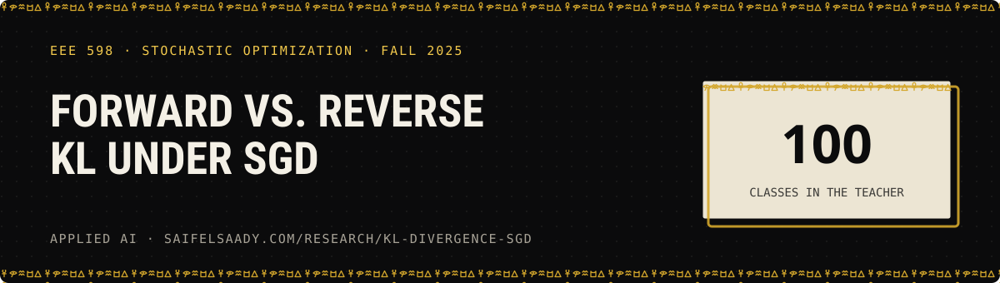

# Forward vs. Reverse KL Under SGD

> Mean-seeking or mode-seeking? Two ways to match a distribution, the same noisy optimizer, and very different behavior.

**EEE 598 · Stochastic Optimization · Fall 2025** · Individual project · Applied AI

| **100** | **80** | **20** | **2** |
|:-:|:-:|:-:|:-:|
| classes in the teacher | optimization runs | seeds per configuration | batch sizes (32, 128) |

**Full case study:** [saifelsaady.com/research/kl-divergence-sgd](https://saifelsaady.com/research/kl-divergence-sgd) · **Project page:** [selsaady1.github.io/eee598-stochastic-optimization](https://selsaady1.github.io/eee598-stochastic-optimization/)

## The question

KL divergence is not symmetric. Forward KL punishes a model for missing anything the target covers, so it spreads out (mean-seeking). Reverse KL punishes it for putting mass where the target has none, so it locks onto a few modes (mode-seeking). Knowledge distillation usually uses the first and variational inference the second. This study isolates how that choice interacts with the noise of mini-batch SGD.

## How it works

1. **Teacher.** A fixed multimodal categorical distribution over 100 classes with four modes, sampled 10,000 times.
2. **Student.** A softmax-parameterized distribution trained with mini-batch SGD with momentum, so every gradient step sees only a noisy sample of the teacher.
3. **Design.** Two objectives × two batch sizes (32 and 128) × 20 independent seeds: 80 runs, everything else held fixed.
4. **Measures.** Iterations to convergence, final loss, total-variation distance to the teacher and mode coverage, compared with two-sample t-tests.

## What it found

- The results lined up with the theory: forward KL spread its mass across the teacher's modes, while reverse KL concentrated on fewer of them.
- Reverse KL was the more sensitive of the two to mini-batch noise.
- Larger batches reduced run-to-run variance for both objectives.

## Takeaway

> Choosing a divergence is choosing a failure mode. If missing a mode is costly, forward KL is the safer default under noisy gradients.

## In this repository

| Path | What it is |
|---|---|
| [`docs/Final_Report_EEE598.docx`](docs/Final_Report_EEE598.docx) | Final report (Word) |

## Tools

Python · NumPy · Matplotlib · SGD with momentum · t-tests

## License

MIT, see [`LICENSE`](LICENSE).

---
_Part of [Saif Elsaady's portfolio](https://saifelsaady.com/projects). Deliverables only; routine homework, quizzes and exams are excluded._
